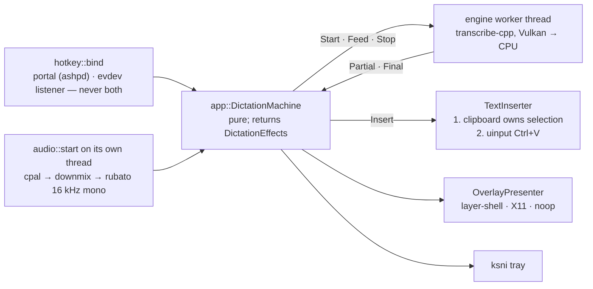

# Repository Guidelines

## Project Overview

**Littera** — local voice dictation for Linux/Wayland. Global hotkey → speak → the transcript is inserted at the cursor of the focused application. ASR runs **fully in-process** (`transcribe-cpp` 0.4 → vendored transcribe.cpp/ggml, Vulkan with CPU fallback); no cloud, no account, no separately installed speech runtime.

- Single **binary** crate: `name = "littera"`, `edition = "2024"`, `rust-version = "1.98"`, `publish = false`. No `src/lib.rs`, no `[[bin]]`/`[lib]`, no `[workspace]`, no `[features]`, no `[dev-dependencies]`, no `[lints]`.
- **The specs are the requirements source of truth**: the base spec `.spec/wayland-voice-dictation.md` (Scenarios, `FR-001…FR-022`, `SC-001…SC-010`) plus the feature specs under `.spec/` — `audio-input-device-selection.md`, `in-app-model-catalog.md`, `model-list-field-rows.md`, `model-load-feedback-and-idle-unload.md`, `speech-bubble-app-icon.md`, `human-readme-writer-skill.md`, `update-check-and-self-update.md` (FR-023…FR-028). Ids are **spec-scoped**: the same number names different requirements in different files (base FR-012 is clipboard restore, the model-load spec's FR-012 is the not-resident state, and so on). Name the spec in a citation that could be ambiguous, and treat a test that pins a spec literal as intentional, not redundant.
- **Platform scope: Linux + a Wayland session, nothing else — do not widen it.** The
  target is a Wayland compositor on a Linux desktop (COSMIC, KDE Plasma,
  Hyprland/wlroots, GNOME 48+). There is no macOS, Windows or BSD target, and **no
  X11-session support**: X11 appears *only* as an XWayland fallback inside a Wayland
  session, in exactly two places — the GNOME overlay window (`src/overlay_x11.rs`,
  because mutter implements neither `zwlr_layer_shell_v1` nor a non-focusing Wayland
  toplevel) and the X11 `CLIPBOARD` bridge (`src/clipboard.rs`, for compositors without
  a data-control protocol). Keep that shape: new code must stay Wayland-first, probe
  the capability at runtime and degrade to a documented, user-visible fallback
  (diagnostics + overlay/notice text) instead of assuming a protocol or routing around
  Wayland with a non-Wayland mechanism. Never add a hard X11/Xorg dependency, an
  X11-only code path that is not a fallback, or a non-Linux code path.
- Out of scope by spec: cloud/BYOK models, transcript history, custom dictionaries,
  meeting transcription, accounts, macOS/Windows.
- Repo state: branch `main`, `origin` = `github.com/RouHim/littera` (**public**), and the repo releases itself: `.github/workflows/{ci,release,pr-title}.yml`, semantic-release (`.releaserc.json`, `package.json`), `renovate.json`, the AUR and Debian packaging in `packaging/` and the version bumper `scripts/bump-version.sh`. Every `feat`/`fix`/`perf` commit that lands on `main` produces the next `vX.Y.Z` tag, the GitHub release assets (tarball, standalone `littera-x86_64` binary and `.deb`) and the AUR push. The shipped desktop entry is `assets/icon/littera.desktop`; `install-desktop.sh` installs it together with the hicolor icon set (README).

## Architecture & Data Flow

Flat crate: 27 `.rs` files directly in `src/`, every module declared at the crate root (`src/main.rs`) — no nested module trees (spec FR-021). Layers: **CLI/daemon (`main.rs`)** → **`app` (state machine + wiring)** → **iced surfaces (`ui`, `ui_onboarding`, `ui_settings`, `ui_problems`)**; platform adapters `audio`, `engine` (with `stream_lease` owning the session/stream borrow), `hotkey{,_device,_portal}`, `clipboard`, `inserter`, `overlay{,_render,_wayland,_x11}`, `tray`, `ipc`; infrastructure `config`, `model_catalog` (the bundled, versioned snapshot of the `transcribe.cpp` catalog), `models` (verified downloads), `diagnostics` + `vulkan_icd` (the capability checks and the missing-driver advice they show), `logging`, `update` (one startup release check and the in-place update for binaries Littera owns).



Key structural rules:

- `DictationMachine` (`src/app.rs`) is **pure**: `hotkey/chunk/partial/queued/final_text/insert_finished/failed/tick` each take an injected `now: Instant` and return effects. All I/O, spawning and UI mutation happen in `App::run` (`src/app.rs`). Never put I/O, `Instant::now()` or a channel send into the machine.
- **Blocking native work runs on dedicated `std::thread`s with `std::sync::mpsc`; tokio exists only where async is inherent** (ashpd portals, the `ureq` model download, `tokio::net` IPC, `ksni`, iced tasks). `src/engine.rs`: "Nothing here runs on a tokio task." `src/models.rs` states the project rule that blocking work never occupies a tokio worker.
- One process-wide inbound channel: `static EVENT_CHANNEL: OnceLock<…>` (`src/app.rs`) fed by pump threads, tray and IPC, drained by the iced subscription `Subscription::run(event_stream)` (`src/app.rs`). Every producer goes through `AppEvent`.
- iced owns the tokio multi-thread runtime (`iced::daemon(…).run()` in `run_daemon`, `src/main.rs`); the app never builds one, except in the two verification CLI paths that run without iced (`main.rs`).
- Single instance: `ipc::notify_running_instance(OpenSettings)` at daemon start forwards "open settings" to `$XDG_RUNTIME_DIR/littera/ipc.sock` and exits 0.

## Key Directories

| Path | Purpose |
| --- | --- |
| `src/` | Entire application, flat: one responsibility per file (see Important Files) |
| `.spec/` | the main spec (`wayland-voice-dictation.md`, FR-001…FR-022) and the feature specs (model catalog, list rows, idle unload, update check); the requirements authority |
| `PRODUCT.md` / `DESIGN.md` / `.impeccable/` | Design context (Impeccable): product truth in `PRODUCT.md` (schema-tagged), the visual system in `DESIGN.md` (token frontmatter + the `.impeccable/design.json` sidecar), the chosen direction contract in `.impeccable/surfaces/*.md`; ephemeral decision/round state under `.impeccable/mocks/` and `.impeccable/review/` is gitignored. The skill itself is vendored at `.agents/skills/impeccable/` (omp loads it project-scoped; the engine binary under its `scripts/bin/` is gitignored and re-downloaded) |
| `assets/` | `icon/` — the master `hicolor/scalable/apps/littera.svg`, its seven `hicolor/<N>x<N>/apps/littera.png` renders (`rsvg-convert`, no build-time rasterizer) and `littera.desktop`; the 256 px render is `include_bytes!`-embedded as `ui::ICON_PNG` (tray pixmap + window icon). Fonts `AtkinsonHyperlegible-Regular.ttf`, `AtkinsonHyperlegible-Bold.ttf` + the OFL license; `banner.png` is the README banner, `screenshot.png` the settings window |
| `samples/` | `jfk.wav`, 11 s 16 kHz mono PCM fixture for the `--audio-file` path (not read by any `#[test]`) |
| `.github/` | CI and release automation: `ci.yml` (fmt/clippy/test in an `archlinux:base-devel` container), `release.yml` (semantic-release → Arch tarball + AUR push, plus a Debian `.deb` build/verify before attaching it to the release), `pr-title.yml` (Conventional PR titles), `aur_known_hosts` (pinned AUR host keys) |
| `packaging/` | AUR `PKGBUILD` template + `littera-bin.install`, and the Debian `debian/control.in` template, all rendered by `release.yml`; the AUR recipe installs the published tarball while the Debian package is compiled from the release tag in its own job |
| `scripts/` | `bump-version.sh`, the semantic-release prepare step that rewrites `Cargo.toml`/`Cargo.lock` |
| `target/` | Build output, gitignored (`.gitignore`: `/target` + Rust backup/editor/OS noise); contains the CMake trees of `transcribe-cpp-sys` |

### Spec index

`FR-*`/`SC-*` ids restart in every file; cite the file when a number could be ambiguous.

| Spec | Scope | Ids |
| --- | --- | --- |
| `wayland-voice-dictation.md` | Base MVP: scenarios, architecture, compositor handling | FR-001…FR-022, SC-001…SC-010 |
| `audio-input-device-selection.md` | Microphone picker and device persistence | FR-001…FR-016 |
| `in-app-model-catalog.md` | Bundled catalog, ratings, recommendation | FR-001…FR-012 |
| `model-list-field-rows.md` | Settings model list layout | FR-001…FR-014 |
| `model-load-feedback-and-idle-unload.md` | Load states, idle unload, notice text | FR-001…FR-016 |
| `speech-bubble-app-icon.md` | Icon design and assets | FR-001…FR-010 |
| `human-readme-writer-skill.md` | README rewrite brief (references base ids) | — |
| `update-check-and-self-update.md` | Release check, ownership gate, in-place update | FR-023…FR-028 |

Absent on purpose: `tests/`, `benches/`, `examples/`, `Makefile`/`justfile`, `docs/`, `CONTRIBUTING`, `rustfmt.toml`/`clippy.toml`/`.editorconfig`, `rust-toolchain.toml`/`.cargo/config.toml`. `CHANGELOG.md` is generated by semantic-release, not maintained by hand; `package.json` exists only for the release tooling.

## Development Commands

```sh
# System deps (Arch; required before the first build)
sudo pacman -S --needed base-devel cmake vulkan-headers spirv-headers vulkan-icd-loader shaderc alsa-lib blas cblas libxkbcommon libxcb

cargo build --release            # slow: CMake builds transcribe.cpp + ggml (CPU + Vulkan), ~200 .comp shaders
./target/release/littera          # first run: onboarding (model, language, key, system check)

# Release tooling (a push to main runs this on GitHub; locally it is a preview)
npx semantic-release --dry-run   # next version from the merged PR titles, no tag
./scripts/bump-version.sh 0.2.0  # exactly what semantic-release's prepare step runs

# Verification quick reference (DEVELOPMENT.md, "Verification")
cargo fmt --check
cargo clippy --all-targets -- -D warnings
cargo test
cargo test -- --ignored                       # overlay window-property smoke tests (they self-skip without a display)
cargo run --release -- --diagnostics
cargo run --release -- --audio-file samples/jfk.wav --print-transcript --latency
LITTERA_OVERLAY=x11 cargo run --release        # exercise the GNOME/XWayland overlay path locally
```

The spec words the lint gate as `cargo clippy -- -D warnings` (FR-020/SC-008); the `--all-targets` form above (also used by CI) is the stricter one. Run that form.

CLI surface is exactly `--version`, `--diagnostics`, `--audio-file <16-kHz-mono-PCM-WAV> [--print-transcript] [--latency]`; unknown args print usage and exit 2. `--audio-file` also triggers the model download if the GGUF is missing (`src/main.rs`).

## Code Conventions & Common Patterns

- **Formatting/lints are tool defaults** — no `rustfmt.toml`, no `clippy.toml`, no `[lints]` table. Match surrounding style instead of inventing config.
- **`unwrap`/`expect` are compile-time banned outside tests**: `#![cfg_attr(not(test), deny(clippy::unwrap_used, clippy::expect_used))]` (`src/main.rs`). Use `?`, `.context(…)`, `bail!`, or `ok_or_else`.
- **Errors**: `anyhow::Result` everywhere; `.context("…")` on `?` at boundaries (`src/main.rs`). Typed errors exist only where the UI needs structure — `BindError { detail, remediation }` (`src/hotkey.rs`) and `PortalError` (`src/hotkey_portal.rs`). Cross-module failures travel as `String` via `format!("{error:#}")`.
- **User-visible strings are module `const`s** (reasons, remediations, failure texts), e.g. `src/overlay_wayland.rs`, `src/clipboard.rs`, `src/inserter.rs`. Tests pin them verbatim — change the const and the test together, never loosen the test.
- **Module docs (`//!`) cite FR/Scenario ids** and explain the *why* of non-obvious choices (why `smithay-clipboard` is unused, `src/clipboard.rs`). Every new file follows this.
- **RAII keepalives**: mechanisms stop when their handle drops — `impl Drop for Engine` (`src/engine.rs`), `impl Drop for DeviceKeepAlive` (`src/hotkey_device.rs`), `impl Drop for Inner` (`src/hotkey.rs`, logs the mechanism's liveness when the binding retires). `StreamLease` (`src/stream_lease.rs`) has no `Drop` impl on purpose: its field order (`stream` before `_session`) makes the language drop the stream first.
- **Structured `tracing` with field syntax; degrade, don't die**: `tracing::warn!(%error, "overlay presentation failed; continuing without the indicator")` (`src/app.rs`). No tray host / no layer-shell / no `/dev/uinput` are *expected* degradations, not bugs.
- **Edition 2024 idioms used freely**: let-chains (`if let Some(d) = &self.download && d.is_running()`, `src/app.rs`), `is_none_or`, `as_chunks_mut`.
- Naming: `snake_case` descriptive verb phrases for functions/tests, `CamelCase` types, `SCREAMING_SNAKE` consts. One module ≈ one concern; split rather than nest.

**Invariants you must not break** (mostly encoded in comments/consts):

- Clipboard must own the selection **before** the paste chord is emitted (`src/inserter.rs`, FR-013) — reverse it and the focused app pastes stale content.
- Auto-paste snapshots the text selection it displaces **before** `copy_text` and restores it only after the focused application **fetched** the transcript — the clipboard source records the fetch (`FetchTicket`, `src/clipboard.rs`) and the insert waits for it up to `CLIPBOARD_RESTORE_GRACE` (`src/inserter.rs`); when nothing fetches, the transcript stays on the clipboard and the outcome says so. `Clipboard::restore` must yield to a newer copy (it checks the live owner on X11, the source state on Wayland) and must never run in clipboard-only mode (FR-012).
- A dictation may insert **exactly once** (FR-006); `pending_finals` accounts for finals still in flight, including late finals from a previous cycle.
- Stale audio is dropped by `chunk_generation` (`src/app.rs`), and `StopEngine` must be sent even for too-short recordings so the model lease is released (`src/app.rs`).
- **Global allocator**: `#[global_allocator] static GLOBAL: mimalloc::MiMalloc` at the crate root (`src/main.rs`), compiled in by the `mimalloc` crate (its C sources are built by `cc`, linked statically). Deliberate, not incidental: the daemon allocates concurrently and frees cross-thread — most visibly the capture callback's fresh buffer is dropped by the capture thread — the pattern glibc's allocator answers with an arena lock. Keep it the only `#[global_allocator]`, and keep it unconditional: no `cfg(target_env = "musl")` gate, this crate has no musl target. The `--audio-file` path is pacing/inference-bound — an interleaved A/B on `samples/jfk.wav` showed no allocator-visible difference; judge allocator work on allocation-heavy shapes, not on it.
- One stream at a time holds the model lease (`StreamLease::open` in `src/stream_lease.rs` retries `Busy` 5×20 ms); audio is routed via `audio_owner` (`src/engine.rs`).
- `MIN_HOLD = 300 ms` (tap vs hold-to-talk), 5-minute cap, 100 ms partial throttle, `PASTE_CHORD_HOLD = 25 ms`, 2 s clipboard confirm timeout — all pinned by tests.
- The only `unsafe` in the tree is `src/stream_lease.rs` (two blocks: `&'static mut Session` plus `mem::transmute` to `Stream<'static>`). It is safe for three reasons that live *only* in that module: `session` is a `Box` (stable address), `_session` is declared after `stream` (drop order), and both fields are private, so nothing outside can touch the session while the stream is alive. Keep it that way — do not unbox the session, reorder the fields, expose an accessor, or open a stream anywhere else.
- The portal path needs an identity: `hotkey_portal` registers the shipped desktop entry's stem (`littera`) with `org.freedesktop.host.portal.Registry` on the very connection the `GlobalShortcuts` calls use, because a caller the portal cannot identify is refused with `NotAllowed: An app id is required` and never gets a dialog. `ashpd::register_host_app` cannot express that id (its `AppID` demands a dotted name while the portal resolves app info from the installed desktop file), so the registration is a direct `zbus` call — and the desktop entry (`littera.desktop`, README install step) must be installed, or the portal probe reports the capability as unavailable. A portal binding counts only when it reports the combination that was asked for (`portal_honoured`): the portal answers from its own per-application store once it holds a shortcut, and that chord must never replace what the user just recorded — the device listener serves the recorded combination instead, with the reason on the card.
- The self-updater (`src/update.rs`) must never write a binary it does not own: package-managed (`pacman -Qo` / `dpkg -S`), outside `$HOME`, inside a cargo `target/`, or unwritable (file or directory) all mean "notice only". A replaced binary is proved first: published SHA-256, `--version` output, then a same-directory rename. The check runs once per start, off the boot path, and only in the daemon — never in `--diagnostics` / `--audio-file`.
- X11 overlay properties must be set **before the first `map_window`** (`overlay_x11.rs` module docs).
- The engine's language hint must be spelled exactly as the loaded GGUF advertises the language (the C API refuses anything else, in `transcribe_run` *and* `transcribe_stream_begin`): `model_catalog::language_hint` picks an advertised spelling of the configured language — the locale for Nemotron 3.5 (`de-DE`), the bare code for Voxtral and the English-only variants (`de` → `de`) — and `None` for a language the variant does not advertise (warn, run without a hint — FR-011). Never invent a hint spelling. The configured vocabulary is `config::Language`'s table (one locale per language the catalog can serve, `auto` first), which the onboarding pick list, the settings pick list and the model-list filter all share.
- The Parakeet stream extension is attached only after probing `Model::accepts_ext(ExtSlot::Stream, TRANSCRIBE_EXT_KIND_PARAKEET_STREAM)` (`stream_extension`, `src/engine.rs`): the kind is a per-variant property (cache-aware vs chunked-attention vs neither), and an unaccepted kind fails `transcribe_stream_begin`. A variant that accepts the kind but refuses the requested lookahead falls back to its own default instead of losing the dictation.
- The engine keeps `keep_special_tags = true` (`run_options_for`, `src/engine.rs`) and removes the model's `<…>` tags itself via `strip_language_tags` before the text is displayed, copied or typed — that is what makes the *detected* language reachable (Spec: Dictation session, "the language actually used"). Never let a tag reach the overlay, the clipboard or `/dev/uinput`, and never turn `keep_special_tags` off without providing the language another way.

## Important Files

| File | Role |
| --- | --- |
| `src/main.rs` | Entry, 3 CLI modes, single-instance guard, `run_daemon`, crate-level lint attr, all `mod` decls |
| `src/app.rs` | `App`, `AppEvent`, pure `DictationMachine` + `DictationState`/`Gesture`/`DictationEffect`, effect execution, iced `boot`/`update`/`subscription`, downloads |
| `src/engine.rs` | ASR worker thread: model load/SHA preflight, backend probe + CPU retry, `EngineCmd`/`EngineEvent`, `AudioOwner`, partial throttling |
| `src/audio.rs` | cpal capture thread, downmix + `rubato` resample to 16 kHz mono, `Chunk`, WAV reader for `--audio-file` |
| `src/hotkey.rs` | Chord parse/normalise (`parse_chord`, `Chord`, `BindError`), mechanism selection (`portal` first, device fallback) |
| `src/hotkey_device.rs` | evdev listen-only listener: thread per keyboard, `ChordState`, hotplug supervisor |
| `src/hotkey_portal.rs` | `ashpd` GlobalShortcuts portal binding; registers the app id (`littera`, the desktop entry's stem) with the portal registry over `zbus` |
| `src/clipboard.rs` | In-process selection ownership: `zwlr_data_control_v1` → `ext_data_control_v1` → X11 `CLIPBOARD` (XWayland bridge) → core `wl_data_device`; one thread each via `calloop`; `snapshot`/`restore` read the displaced selection back (FR-012) |
| `src/inserter.rs` | `TextInserter` trait, `UinputInserter` (Ctrl+V via `/dev/uinput`), `ClipboardOnlyInserter` fallback, `InsertOutcome` |
| `src/overlay.rs` / `overlay_render.rs` / `overlay_wayland.rs` / `overlay_x11.rs` | Presenter trait + backend probe/override; shared tiny-skia/cosmic-text frame render; layer-shell thread; X11 notification window thread |
|`src/ui.rs` / `ui_onboarding.rs` / `ui_settings.rs` / `ui_problems.rs`|Shared iced vocabulary (messages, `palette`/`metrics`/`style` design tokens, the reading-face widget helpers, `ChordCapture`, `Step`), onboarding, settings (autosave — every edit applies immediately; config persistence and live reload), startup problem notice (FR-014)|
| `src/config.rs` | `Config`, `Language`, `BackendPreference`, `HotkeySource`, `IdleUnload`, `SharedConfig = Arc<RwLock<Config>>`, atomic TOML save, XDG paths |
|`src/model_catalog.rs`|Bundled catalog snapshot: 8 streaming variants × 23 artifacts (size + SHA-256 + commit-pinned HF URL), ratings (accuracy/speed), the per-model quant recommendation the settings rows preselect (`Variant::recommended`, rule + tripwire test in the module; the compute backend deliberately plays no part in it), pure selection/language/rating helpers|
| `src/models.rs` | `path_for`, resumable verified `ensure` (`<file>.part` + `Range` + SHA-256 + free-space gate) for a `model_catalog::Artifact` |
| `src/update.rs` | One startup release check (GitHub `/releases/latest`, 5 s, silent failure) and the in-place update: ownership gate, `littera-x86_64` download, SHA-256 verify, `--version` proof, same-directory rename; notice text per route |
| `src/ipc.rs` / `tray.rs` / `diagnostics.rs` / `vulkan_icd.rs` / `logging.rs` | Single-instance socket + JSON-line codec; ksni tray; the four system checks; the missing-Vulkan-driver advice a failed GPU check shows (`/sys/bus/pci/devices` + `/usr/share/vulkan/icd.d` + the package manager on `PATH`, no distro assumed); `tracing-subscriber` init |
| `build.rs` | Emits `-lcblas` when a `cblas.h` exists and `CBLAS_NO_LINK` is unset (transcribe-cpp-sys only names `libblas`); no-op off Linux |
| `.github/workflows/{ci,release,pr-title}.yml` | Gates on Arch, the semantic-release → build → AUR chain plus the `.deb` build/verify, and the Conventional PR-title check |
| `packaging/PKGBUILD` + `littera-bin.install` | AUR packaging template rendered with `pkgver`/`sha256` at release time; `arch=('x86_64')`, prebuilt archive |
| `packaging/debian/control.in` | Debian control template rendered with version, readelf-derived glibc floor and `Installed-Size` at release time; no maintainer scripts |
| `scripts/bump-version.sh` | Rewrites the crate version in `Cargo.toml` and the `littera` block in `Cargo.lock`; semantic-release's prepare step |
| `install-desktop.sh` | One-command user install of the desktop entry and the hicolor icon set (FR-009); works from a checkout or the release tarball |
| `LICENSE` | MIT |
| `README.md` | User-facing overview: install routes, use, configuration keys, updates, troubleshooting |
| `DEVELOPMENT.md` | Operations reference: build deps, verification, CLI flags, env vars, link/`dlopen` and permission tables, release pipeline |

## Runtime/Tooling Preferences

- **Toolchain**: stable Rust ≥ 1.98 (edition 2024). No `rust-toolchain.toml` — the MSRV is declarative only. Cargo is the only build tool; no task runner in the repo.
- **Native build**: needs `cmake ≥ 3.16`, a C/C++ compiler, `make`, `pkgconf`, `glslc` + `glslangValidator`, Vulkan **headers and the loader stub** (`vulkan-icd-loader` — ggml links `libvulkan.so`), SPIRV headers, ALSA headers, `blas` + `cblas` (the `.deb` job omits the last two), and `libxkbcommon` + `libxcb`: `smithay-client-toolkit`'s default features compile an xkbcommon binding through `pkg-config`, and `x11rb`'s `allow-unsafe-code` links `libxcb`. Not needed: the remaining Wayland/X11 dev packages, `libclang`/bindgen (bindings are committed), Python, OpenMP, `ydotool`. The vendored C++ is linked **statically** (`shared = false`, backends `vulkan`+`cpu`).
- **`GGML_NATIVE=ON`** in the vendored CMake build → a local `cargo build` is host-CPU-tuned (`-march=native`) and **not portable** to other machines. The release workflow overrides that with `TRANSCRIBE_CMAKE_ARGS=-DTRANSCRIBE_X86_CONSERVATIVE=ON` (the crate's SIGILL-safe switch: `GGML_NATIVE` plus every x86 SIMD tier off), so the published tarball runs on baseline x86-64.
- **No fully static build exists for this crate.** The Vulkan loader is a shared object that `dlopen`s the ICD, `libwayland-client`/`libxkbcommon`/`libX11`/`libXi`/`libxcb` are loaded at runtime by the windowing stack, and ALSA `dlopen`s its PCM plugins — a static musl binary fails at the first of these. The AUR package therefore declares `alsa-lib`, `vulkan-icd-loader`, `blas`, `cblas`, `wayland` and `libxkbcommon` and ships a dynamically linked glibc binary.
- **Runtime**: the binary's dynamic `NEEDED` set (verified with `readelf -d`) is `libasound`, `libc`, `libgcc_s`, `libm`, `libstdc++` and `libvulkan`; the tarball/AUR build also links `blas`/`cblas` (+ `libgfortran` via `blas`), while the `.deb` is built with `TRANSCRIBE_USE_SYSTEM_BLAS=OFF` (scalar host decoder) and needs neither. `dlopen`ed: `wayland-client`, `xkbcommon`, `xkbcommon-x11` and — only on the X11/Xwayland paths — `X11`, `Xi`, `xcb`. iced builds `Renderer::All`: the `wgpu` renderer is enabled and preferred at runtime, with `tiny-skia`/`softbuffer` as the CPU fallback, so a usable Vulkan adapter is recommended but not required (FR-005). Optional components degrade by design: no Vulkan → CPU; no `xdg-desktop-portal` `GlobalShortcuts` → evdev device listener; no StatusNotifier host → no tray; no PipeWire → ALSA; missing `uaccess` on `/dev/uinput` or `/dev/input/event*` → clipboard-only or portal route. `--diagnostics` reports each with remediation.
- **Config** `~/.config/littera/config.toml`: `onboarding_complete`, `model` (catalog id, default `nemotron-3.5-asr-streaming-0.6b-Q8_0`), `language` (`auto` or a locale from the catalog's language table — 32 languages, default `auto`; an unknown token falls back to `auto`), `hotkey` (default `CTRL+SUPER`), `hotkey_source` (`portal|device`), `backend` (`auto|vulkan|cpu`), `input_device` (`system|<host>:<device>`, default `system`, key omitted while default), `idle_unload` (`never|1|5|15|30|60` minutes, default `15`, always written; an unrecognized value falls back to the default). Models live in `~/.local/share/littera/models` (default 751 MB, downloaded on first dictation, SHA-256-verified).
- **Env vars**: `RUST_LOG` (default `littera=info`, stderr), `LITTERA_OVERLAY=layer|x11` (force overlay backend), `LITTERA_HOTKEY_PORTAL=0` (skip the portal, force the device listener), `XDG_RUNTIME_DIR` (required for the IPC socket), `DISPLAY`/`WAYLAND_DISPLAY`; build-time `CBLAS_NO_LINK`, `TRANSCRIBE_DIR`, `TRANSCRIBE_CMAKE_ARGS`, `CMAKE_ARGS`, `VULKAN_SDK`, `GGML_CCACHE=OFF`.

## Testing & QA

- All tests are **inline `#[cfg(test)] mod tests` blocks at the end of the file** (23 of 27 modules): 252 `#[test]` fns, of which 244 run by default and 8 are `#[ignore]` (the count drifts as work lands). No `tests/`, no test fixtures at all, no dev-dependencies, and no `#[tokio::test]` — an async seam is driven through a small current-thread runtime instead.
- Run: `cargo test` (unit), `cargo test -- --ignored` (display-dependent smoke), single test via module path: `cargo test app::tests::hold_to_talk_stops_on_release -- --exact`, whole module: `cargo test config::tests`. No feature flags exist (`--features` fails), and there is no lib target, so doc tests do not apply.
- CI runs the same three gates (`cargo fmt --check`, `cargo clippy --all-targets -- -D warnings`, `cargo test`) inside `archlinux:base-devel`, i.e. on the toolchain the AUR package builds against, and caches `~/.cargo` + `target` — a green local run and a green CI run still differ in compiler version, so treat CI as the authoritative one.
- Style to follow:
  - Descriptive snake_case sentence names, no `test_` prefix: `save_then_load_roundtrips_and_leaves_no_temp_file` (`src/config.rs`), `rejects_48k_stereo_wav_with_the_contract_literal` (`src/audio.rs`).
  - **Pin contract literals as `const`s inside the test module** and compare with production consts/strings (`src/hotkey.rs`, `src/diagnostics.rs`, `src/models.rs`). Comments cite FR/SC ids.
  - Inject time instead of sleeping: `machine.hotkey(Press, t0)` / `(Release, t0 + MIN_HOLD + 1 ms)` (`src/app.rs`).
  - Channel assertions are timeout-bounded: `Err(RecvTimeoutError::Timeout)` within 200 ms, liveness within 10 s (`src/engine.rs`). The engine worker is driven synchronously over `std::sync::mpsc`, not `#[tokio::test]`.
  - Temp files are hand-rolled under `std::env::temp_dir()` namespaced by `std::process::id()` (+ counter in `src/models.rs`) and removed at the end; tests must never write below `$HOME`. `src/config.rs` also asserts no `config.toml.tmp` survives.
  - Global-clipboard tests serialise on `pub(crate) static SELECTION_LOCK` (`src/clipboard.rs`) — hold it in any new test that touches the selection.
  - `unwrap`/`expect` are fine in tests (allowed by the `cfg_attr` in `src/main.rs`).
- The 8 `#[ignore]` tests are live smoke tests: X11 window properties (`src/overlay_x11.rs`), layer-shell show/draw/hide (`src/overlay_wayland.rs`), clipboard ownership plus snapshot/restore (`src/clipboard.rs`, `src/inserter.rs`, needs `wl-clipboard` for the fixtures and independent verification), and the GitHub release endpoint (`src/update.rs`, needs the network). They share `main.rs`'s `test_support` guards: a missing session or tool prints one skip line and returns, so a headless run never reports green for a test that touched nothing.
- Coverage gaps to respect before widening scope: **no tests** in `logging.rs`, `ui_onboarding.rs`, `ui_problems.rs`, `hotkey_portal.rs`; **no coverage** of `update::install` (download/verify/swap; the endpoint parse is the ignored live test), `ipc::serve`, tray runtime registration, iced `boot`/subscription wiring, real cpal capture, real ASR inference and `build.rs`. `models::ensure` is covered by an HTTP-fixture suite (resume, ignored `Range`, oversize discard, free-space gate, tamper, cancel).
- **No automated non-test verification exists** — for behavior changes, run the matching command from the quick reference (`--diagnostics`, `--audio-file samples/jfk.wav --print-transcript --latency`, or the real daemon) rather than trusting unit tests alone.
