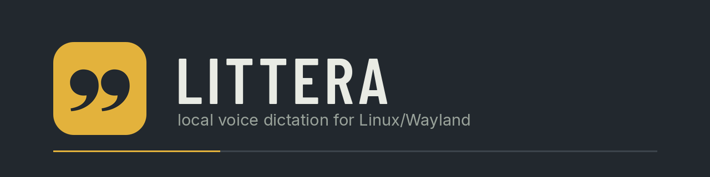
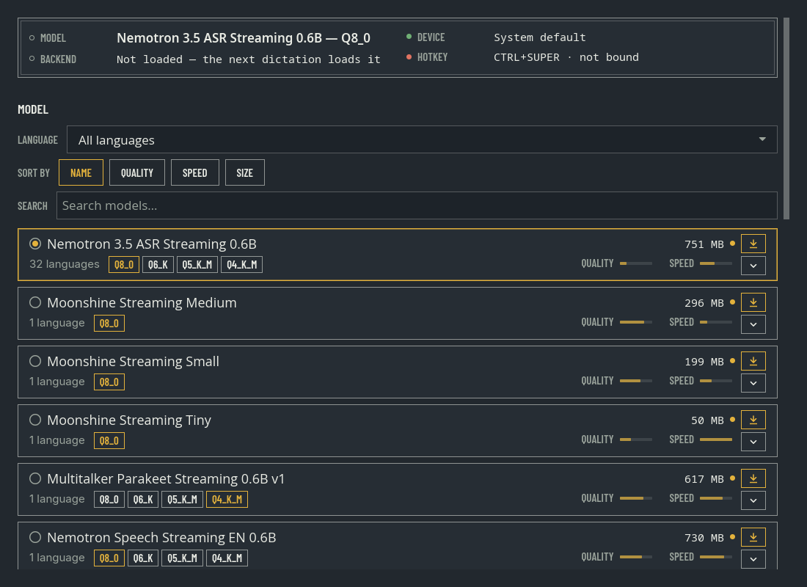

<p align="center">
    <a href="https://github.com/RouHim/littera/actions/workflows/ci.yml"></a>
    <a href="https://github.com/RouHim/littera/releases/latest"></a>
    <a href="https://aur.archlinux.org/packages/littera-bin"></a>
    <a href="LICENSE"></a>
</p>

<p align="center">
    <i>Voice dictation for Linux: press a hotkey, speak, and the text appears at your cursor.</i>
</p>



Littera runs entirely on your machine, with no account and no cloud service.

## Requirements

- Linux with a Wayland session. KDE Plasma, GNOME 48+, Hyprland and COSMIC work. X11 sessions do not.
- A microphone that PipeWire or ALSA can open.
- A Vulkan GPU is recommended. Without one, Littera uses the CPU.

## Install

Arch Linux:

```sh
yay -S littera-bin    # or: paru -S littera-bin
littera
```

Debian 13+ and Ubuntu 24.04+ — grab the `.deb` from the [latest release](https://github.com/RouHim/littera/releases/latest); every asset ships a `.sha256`:

```sh
sudo apt install ./littera_<version>_amd64.deb
littera
```

The first start opens a setup window for model, language, hotkey and a system check. The default model supports 32 languages, is about 750 MB, and downloads on first use. Smaller English-only models are in the settings.

To build from source (Rust 1.98 or newer):

```sh
sudo pacman -S --needed base-devel cmake vulkan-headers spirv-headers vulkan-icd-loader shaderc alsa-lib blas cblas
cargo build --release
./install-desktop.sh
./target/release/littera
```

`install-desktop.sh` installs the desktop entry that the hotkey dialog needs.

## Use

- Tap the hotkey (default Ctrl+Super) to start recording. Tap again to stop.
- Or hold the hotkey while you speak, then release.
- The transcript is pasted at your cursor. Terminals often need Ctrl+Shift+V instead.
- The tray icon opens the settings. Change the hotkey, language or model there. Changes apply immediately.

## Troubleshooting

```sh
littera --diagnostics
```

The check covers hotkey access, paste permission, GPU and overlay. Each failure comes with a fix. Littera also opens a problem window at startup when something is wrong.

- Hotkey does nothing: for a source install, run `./install-desktop.sh` and restart Littera. If the diagnostics ask for it, run `sudo usermod -aG input $USER`, then log in again.
- Nothing is pasted: without write access to `/dev/uinput`, Littera copies the transcript instead of typing it. Paste it by hand. The diagnostics name the blocked path.
- Your files: config in `~/.config/littera/config.toml`, models in `~/.local/share/littera/models`.
- Bugs and questions: [GitHub issues](https://github.com/RouHim/littera/issues).
