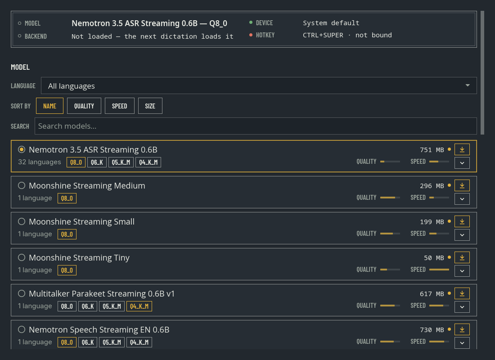

# Littera


Local voice dictation for Linux: press a hotkey, speak, and the text lands at your cursor.



Littera runs entirely on your machine, with no account and no cloud service.

## Requirements

- Linux with a Wayland session. KDE Plasma, GNOME 48+, Hyprland and COSMIC work. X11 sessions do not.
- A microphone that PipeWire or ALSA can open.
- A Vulkan GPU is recommended. Without one, Littera uses the CPU.

## Install

Arch Linux:

```sh
yay -S littera-bin    # or: paru -S littera-bin
littera
```

Debian 13+ and Ubuntu 24.04+ use the `.deb` from the [latest release](https://github.com/RouHim/littera/releases/latest). Every asset has a `.sha256` file:

```sh
sudo apt install ./littera_<version>_amd64.deb
littera
```

Any distribution can use the tarball from the [latest release](https://github.com/RouHim/littera/releases/latest):

```sh
tar xzf littera-<version>-x86_64.tar.gz
install -Dm755 littera-<version>-x86_64/littera ~/.local/bin/littera
./littera-<version>-x86_64/install-desktop.sh
~/.local/bin/littera
```

The installer places the desktop entry and the icon set under `$XDG_DATA_HOME` (default `~/.local/share`), creates missing directories and is safe to re-run. The desktop entry is also what the global-shortcut portal identifies Littera by.

The first start opens a setup window for the model, language, hotkey and a system check. The default model handles 32 languages, is about 750 MB, and downloads on first use. Smaller English-only models are in the settings.

To build from source, see [DEVELOPMENT.md](DEVELOPMENT.md#build-from-source). Rust 1.98 or newer is required.

## Usage

- Tap the hotkey (default Ctrl+Super) to start recording, and tap again to stop.
- Or hold the hotkey while you speak, then release.
- Littera pastes the transcript at your cursor. Terminals often need Ctrl+Shift+V.
- The tray icon opens the settings. Change the hotkey, language or model there; changes apply immediately.
- The settings window names the compute backend: `Vulkan on <device>` when acceleration is active, or the CPU with its fallback reason and driver fix. `backend = cpu` reads as a deliberate `(selected)` choice, not a failure.

## Updates

Once setup is complete, Littera asks GitHub once per start whether a newer release exists and shows the answer in the overlay notice. That check is the only automatic network access, apart from the verified update download when Littera owns the binary. Model downloads stay user-initiated. Nothing about the check is stored.

- A binary installed under your home directory replaces itself in place. The published SHA-256 and the new binary's `--version` must match before it is renamed over the running file. It applies on the next start.
- Littera never writes to a pacman- or dpkg-owned binary. The notice names the route: `yay -Syu` / `paru -Syu` for the AUR package, or the release-page `littera_<version>_amd64.deb`; install it with `sudo apt install ./littera_<version>_amd64.deb`.
- A build run from `target/release` is left alone; rebuild with `cargo build --release`.

## Troubleshooting and help

```sh
littera --diagnostics
```

The check covers hotkey access, paste permission, GPU and overlay. Each failure comes with a fix. Littera also opens a problem window at startup when something is wrong.

- Hotkey does nothing: for a source install, run `./install-desktop.sh` as described in [DEVELOPMENT.md](DEVELOPMENT.md#running-a-checkout-build) and restart. If the diagnostics ask for it, run `sudo usermod -aG input $USER` and log in again.
- Nothing is pasted: without write access to `/dev/uinput`, Littera copies the transcript instead of typing it. Paste it by hand; the diagnostics name the blocked path.
- Files: config in `~/.config/littera/config.toml`, models in `~/.local/share/littera/models`. Every key and default is in [DEVELOPMENT.md](DEVELOPMENT.md#configuration).
- Bugs and questions: [GitHub issues](https://github.com/RouHim/littera/issues).

## License

MIT. See [LICENSE](LICENSE).
